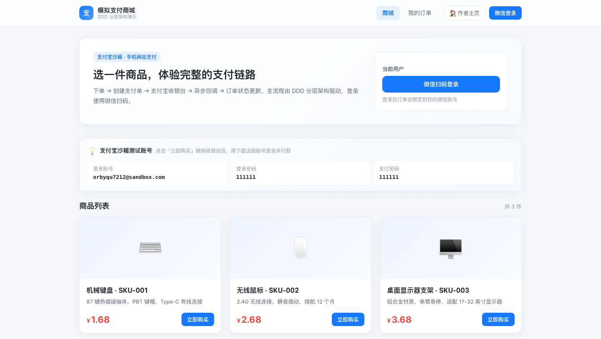
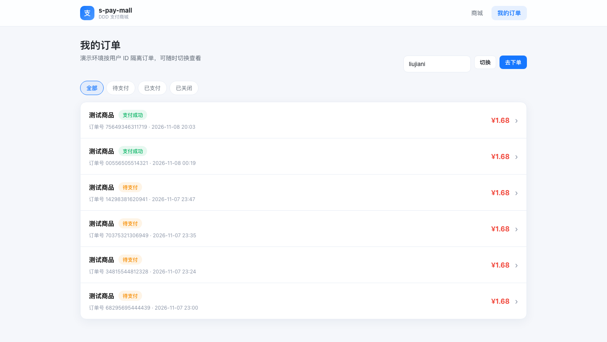
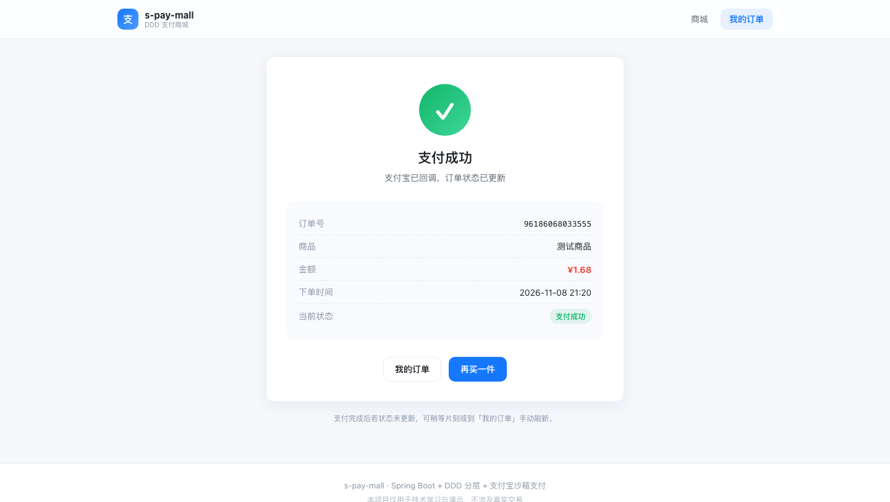

# 模拟支付商城 · DDD 版

一个基于 **Spring Boot + DDD 分层** 的支付商城演示项目：微信扫码登录 → 下单 → 支付宝沙箱支付 → 异步回调验签 → 订单状态机 → 定时补偿。

> 在线演示：<https://mall.dabuw.online>
> 另一版本：[模拟支付商城 · MVC 版](https://github.com/dabuw/s-pay-mall-mvc)



| 我的订单 | 支付结果 |
| --- | --- |
|  |  |

## 功能

- 微信扫码登录（带参二维码 + 扫码事件回调）
- 商品列表、下单、复用未支付订单（防重复下单）
- 支付宝支付：电脑网站支付 / 手机网站支付，通过 `alipay.pay_mode` 切换
- 异步回调：`trade_status` 判断 + RSA2 验签 + 幂等更新
- 订单状态机：`CREATE → PAY_WAIT → PAY_SUCCESS → DEAL_DONE`，超时 `CLOSE`
- 定时任务：查单补偿（30s，带熔断）、超时关单（10min）
- 前端：Vue3 + Vite，商品 / 登录 / 订单 / 支付结果四个页面，支付结果页轮询

## 技术栈

| 类别 | 选型 |
| --- | --- |
| 语言 / 框架 | Java 8 · Spring Boot 2.7.12 |
| 持久层 | MyBatis 2.1.4 + XML Mapper · HikariCP |
| 数据库 | MySQL 8（驱动 8.0.22） |
| 支付 | alipay-sdk-java 4.38.157（沙箱） |
| 缓存 / 事件 | Guava 32.1.3（`Cache` + `EventBus`） |
| 外部调用 | Retrofit 2.9 |
| 前端 | Vue3 + Vite + vue-router + axios |
| 部署 | systemd + Nginx + Let's Encrypt · Docker（MySQL） |

> 说明：项目**没有使用 Redis 和消息队列**。当前规模下单机足够，缓存用 Guava `Cache`、事件用进程内 `EventBus`；
> 领域层通过端口/仓储接口隔离，后续替换为 Redis + MQ 只需要改基础设施层。

## 架构

六个 Maven 模块，依赖方向单向：

```
app               启动类、配置装配
 ├─ trigger        HTTP 入口、定时任务、事件监听
 ├─ infrastructure 仓储实现、外部端口实现（支付宝、微信、商品）
 ├─ domain         聚合 / 实体 / 值对象 / 领域服务 / 仓储与端口接口
 ├─ api            对外 DTO 与接口定义
 └─ types          通用常量、工具、事件基类
```

关键点：`domain` 只依赖 `types`，**不依赖** Spring Web、MyBatis；`infrastructure` 反向实现 `domain` 定义的
`IOrderRepository` / `IProductPort` / `ILoginPort`，由 `app` 完成装配。

## 支付链路

```
客户端               商城后端                      支付宝
  │  POST create_pay_order │                          │
  │───────────────────────>│  1. 查未支付订单（有则复用并刷新支付表单）
  │                        │  2. 查商品、构建聚合、落库（CREATE）
  │                        │  3. pageExecute 生成支付表单 ──────>│
  │<── 返回 form HTML ─────│  4. 更新 pay_url（PAY_WAIT）        │
  │                                                          │
  │  用户提交表单（浏览器自动 POST） ────────────────────────>│ 收银台
  │                                                          │
  │                        │<── 异步通知 alipay_notify_url ───│
  │                        │  5. 校验 trade_status
  │                        │  6. RSA2 验签
  │                        │  7. 幂等更新为 PAY_SUCCESS
  │                        │  8. 发布 PaySuccessMessageEvent
  │                        │
  │  GET order/status ────>│  9. 前端轮询拿最新状态
```

## 定时补偿

| 任务 | 频率 | 作用 |
| --- | --- | --- |
| `NoPayNotifyOrderJob` | 30s | 扫描 `PAY_WAIT` 超 1 分钟的订单，主动 `alipay.trade.query` 补状态；连续失败 3 次熔断 5 分钟 |
| `TimeoutCloseOrderJob` | 10min | 扫描 `PAY_WAIT` 超 30 分钟的订单置为 `CLOSE` |

实现细节：

- 只有 `trade_status ∈ {TRADE_SUCCESS, TRADE_FINISHED}` 才更新为已支付（`code=10000` 只代表查询成功）
- 关单 SQL 带 `status = 'PAY_WAIT'` 条件，避免覆盖已经支付的订单

## 接口

| 方法 | 路径 | 说明 |
| --- | --- | --- |
| GET | `/api/v1/product/list` | 商品列表 |
| POST | `/api/v1/alipay/create_pay_order` | 下单并返回支付宝表单 |
| POST | `/api/v1/alipay/alipay_notify_url` | 支付宝异步通知 |
| GET | `/api/v1/order/status` | 订单状态（轮询） |
| GET | `/api/v1/order/list` | 订单列表 |
| GET | `/api/v1/login/weixin_qrcode_ticket` | 获取扫码登录二维码 ticket |
| GET | `/api/v1/login/check_login` | 轮询扫码结果 |
| GET | `/api/v1/weixin/portal/receive` | 微信服务器地址校验 |
| POST | `/api/v1/weixin/portal/receive` | 微信消息 / 扫码事件回调 |

## 数据表

只有一张表 `pay_order`：

```
id, user_id, product_id, product_name, order_id, order_time,
total_amount, status, pay_url, pay_time, create_time, update_time
```

建表脚本：[docs/dev-ops/mysql/sql/s-pay-mall.sql](docs/dev-ops/mysql/sql/s-pay-mall.sql)

## 本地启动

前置：JDK 8、Maven 3.6+、MySQL 8、Node 18+。

```bash
# 1. 初始化数据库
mysql -uroot -p < docs/dev-ops/mysql/sql/s-pay-mall.sql

# 2. 配置（密钥不入库，用环境变量注入）
export ALIPAY_MERCHANT_PRIVATE_KEY="你的应用私钥"
export ALIPAY_PUBLIC_KEY="你的支付宝公钥"
export WEIXIN_APP_SECRET="你的公众号 secret"

# 3. 启动后端（默认 8080）
mvn -DskipTests package
java -jar s-pay-mall-ddd-ljn-app/target/s-pay-mall-ddd-ljn-app.jar --spring.profiles.active=dev

# 4. 启动前端
cd s-pay-mall-ddd-ljn-ui
npm install
npm run dev          # 默认 5173，/api 代理到 8080
```

主要配置项（`application-dev.yml`）：

```yaml
alipay:
  app_id: 你的沙箱 APPID
  gatewayUrl: https://openapi-sandbox.dl.alipaydev.com/gateway.do
  pay_mode: page     # page=电脑网站支付, wap=手机网站支付
```

## 已知限制

- 支付宝**沙箱**环境，只能使用沙箱买家账号，没有真实资金
- 沙箱收银台偶发不可用（`SYSTEM_ERROR` / `504` / 系统繁忙），属于平台侧问题
- 单机部署，未做高可用；定时任务为单实例运行
- 事件为进程内事件，进程重启会丢失（仅用于触发后续动作，不承载关键状态）

## License

仅用于学习与演示。
